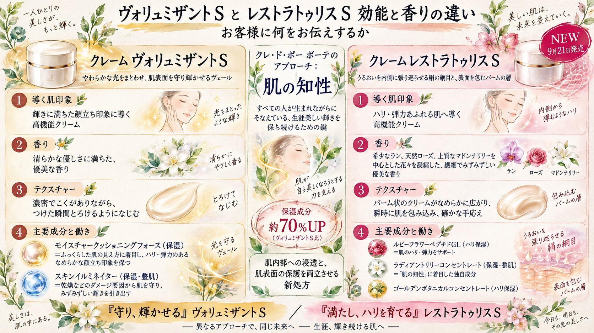

<!-- _class: lead -->

# クレームレストラトゥリスＳ

9月21日 全国一斉発売　店頭向け商品説明資料

クレ・ド・ポー ボーテ

---

## この資料について

レストラトゥリスＳを店頭でご提案いただくための資料です。お客様から最も多く聞かれるのは「ヴォリュミザントＳと何が違うのか」です。そこに答えられる状態をつくることを目的にしています。

- 価格は周知済みのため扱いません
- 本文中の「」は公式サイトの記載をそのまま引用したものです
- 注記（＊）は接客・掲示のいずれでも省略できません

---

<!-- _class: full-image -->
<!-- _paginate: false -->

---

## ヴォリュミザントＳとの違い

|  | ヴォリュミザントＳ | レストラトゥリスＳ |
| --- | --- | --- |
| 導く肌印象 | 輝きに満ちた顔立ち印象 | ハリ・弾力あふれる肌 |
| 保湿成分量 | — | 約70%UP＊ |
| 香り | 清らかな優しさに満ちた、優美な香り | ラン・天然ローズ・マドンナリリー中心 |
| 使用感 | 濃密でこく、つけた瞬間とろける | バーム状、確かな手応え |
| 使う順 | 化粧水・乳液のあと | お手入れの最後 |

＊クレ・ド・ポー ボーテ クレームヴォリュミザントＳ比　／　共通：50g・使用期間 約2.5カ月・原産地 日本

---

## 違い①　保湿成分の配合量

公式が打ち出している一番大きな差分です。数字を出すときは比較対象の注記まで必ずセットで伝えてください。

> 保湿成分の配合量 約70%UP＊　／　＊クレ・ド・ポー ボーテ クレームヴォリュミザントＳ比

あわせて「ローションとあわせて使うことで、先進のベーシックケアが完成し、うるおいに満ちたハリ肌へ導きます」と記載があります。単品ではなくライン提案の根拠になります。

---

## 違い②　新しい処方のしくみ

「肌内部に美容成分の浸透＊と、肌表面の保護を両立させる新たな処方」（＊角層まで）

1. 水分の中に油分が存在するクリームに、美容成分を浮かべる構造
2. 肌に触れた瞬間、美容成分を含むパーツから成分が一気に放出される
3. そのあと油分が油性の膜をつくり、表面を密封保護する

「入れる」と「閉じ込める」を1品で行う、と説明すると伝わります。浸透の話をするときは＊角層までを必ず添えてください。

---

## 違い③　配合成分

| 成分 | 分類 | 公式の説明 |
| --- | --- | --- |
| ルビーフラワーペプチドGL | ハリ保湿 | 肌のハリ・弾力をサポート |
| ラディアントリリーコンセントレート | 保湿・整肌 | 「肌の知性」に着目した独自成分 |
| ゴールデンボタニカルコンセントレート | ハリ保湿 | 今の肌も未来の肌も美しく守り続ける |

ヴォリュミザントＳはモイスチャークッショニングフォース（保湿）とスキンイルミネイター（保湿・整肌）。成分構成そのものが入れ替わっています。

---

## 違い④　香り

店頭で最も体感していただきやすい差分です。まず香りから入るのが有効です。

|  | 香り（公式表記） |
| --- | --- |
| ヴォリュミザントＳ | 清らかな優しさに満ちた、優美な香り |
| レストラトゥリスＳ | 希少なランや天然ローズ、上質なマドンナリリーを中心とした花々を凝縮した、繊細でみずみずしい優美な香りです |

ラン・ローズ・マドンナリリーという三つの花の名前を出せると、香りの印象が具体的に伝わります。

---

## 違い⑤　使用感と使う順番

### テクスチャー

「バーム状のクリームがなめらかに広がり、瞬時に肌を心地よく包み込み、確かな手応えをもたらします」。ヴォリュミザントＳの「とろける」とは手応えが異なります。

### 使う順番が変わります

レストラトゥリスＳは朝と夜、お手入れの最後に、パール粒1コ分。乳液のあとに重ねる流れではない点を、既存のお客様には必ずお伝えください。

---

## ブランドとしての立ち位置

クレ・ド・ポー ボーテのスキンケアは独自のブレインスキン理論に基づき、「肌の知性」を先端サイエンスでサポートしています。

> 「肌の知性」とは、すべての人が生まれながらにそなえている、生涯美しい輝きを保ち続けるための鍵

レストラトゥリスＳはこの考え方の上で「顔全体に張り巡らされた美しさの鍵」に着目した新しいアプローチ、という位置づけです。単発の新商品ではなく、ブランドの軸の延長線上にあると説明できます。

---

## 優先してお声がけしたい方

1. **ハリ・弾力**の悩みを口にされた方。訴求がそのまま合致します
2. **ヴォリュミザントＳの既存のお客様**。違いを説明できる相手で、切り替えの判断材料を求めています
3. **乾燥による小じわ**が気になる方。「乾燥による小じわを目立たなく＊」（＊効能評価試験済み）

輝き・ツヤを最優先されている方には、無理に切り替えを勧める必要はありません。ヴォリュミザントＳが引き続き適しています。

---

## タッチアップの流れ

1. 香りを確認いただく。三つの花の名前を添える
2. 手の甲でバーム状のテクスチャーを体感いただく
3. 「入れる」と「閉じ込める」を両立する処方であることを説明する
4. 使う順番（お手入れの最後）をお伝えする

説明から入るより、香りとテクスチャーを先に体感していただいたほうが、処方の話が入りやすくなります。

---

## ライン提案と再来店

### ローションとあわせて

「ローションとあわせて使うことで、先進のベーシックケアが完成し」と公式に明記されています。クリーム単品ではなくベーシックケアとしてご提案ください。

### 使用期間は約2.5カ月

次回のご来店時期の目安としてお伝えできます。購入時に記録を残しておくと、次の接客につながります。

---

## 表示と注記のルール

| 使う表現 | 必ず添える注記 |
| --- | --- |
| 浸透 | ＊角層まで |
| 保湿成分 約70%UP | ＊クレ・ド・ポー ボーテ クレームヴォリュミザントＳ比 |
| 乾燥による小じわを目立たなく | ＊効能評価試験済み |
| 100%の方が「今後も使い続けたい」 | ＊中国／2024年10月11日〜12月6日／35〜64歳の女性106名 |

アレルギーテスト済み（すべての人にアレルギーが起きないというわけではありません。）／ニキビのもとになりにくい処方（すべての方にニキビができないというわけではありません。）
