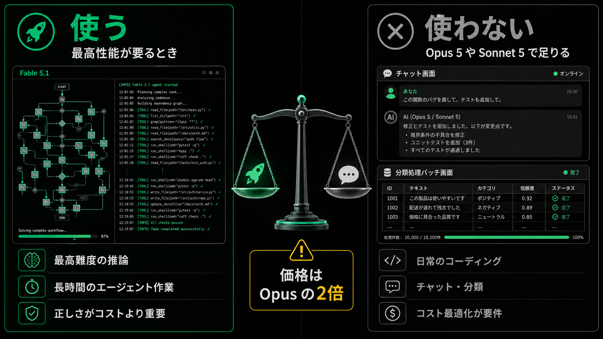
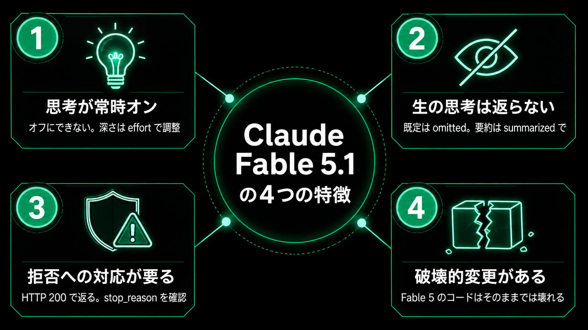
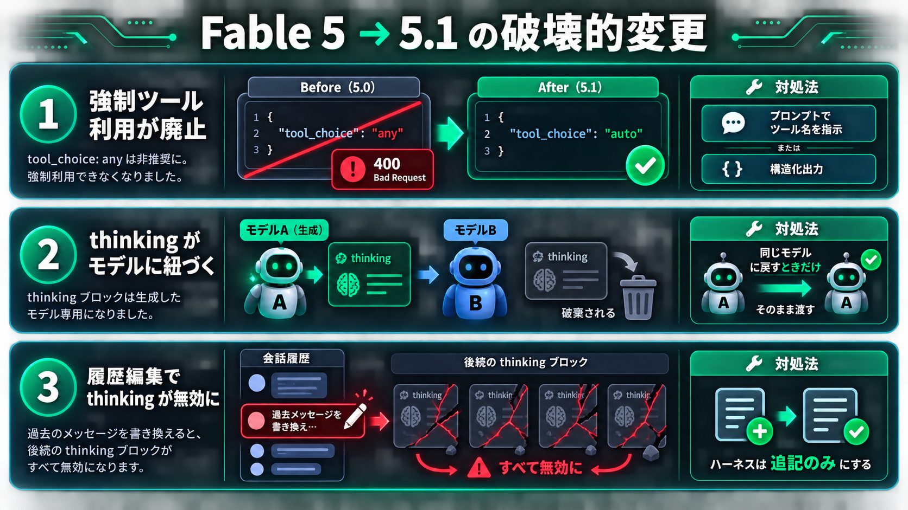

<style>
/* Ensure section is a flex column so block-image can fill remaining space */
section {
  display: flex !important;
  flex-direction: column !important;
}

/* Block-level inline images (non-bg) */
.block-image {
  display: flex;
  justify-content: center;
  align-items: center;
  flex: 1 1 0;
  min-height: 0;
}
.block-image img {
  max-width: 100%;
  max-height: 100%;
  object-fit: contain;
}

/* Block-level spacer (replaces inline <br>) */
.spacer {
  display: block;
  height: 1em;
  flex-shrink: 0;
}
/* Abyss — 深淵
 * 深淵を覗くとき、深淵もまたこちらを見ている。闇の中の光
 */
@import url('https://fonts.googleapis.com/css2?family=Noto+Sans+JP:wght@400;600;700&family=Space+Grotesk:wght@400;600;700&display=swap');

section {
  background-color: #0d0d0d !important;
  color: #e8e8e8 !important;
  font-family: 'Space Grotesk', 'Noto Sans JP', sans-serif;
  font-weight: 400;
  line-height: 1.65;
  font-size: 30px;
  padding: 56px 60px 64px 60px;
  word-break: keep-all;
  overflow-wrap: break-word;
}

section p, section li, section span { color: #e8e8e8 !important; }

/* Allow syntax highlighting colors inside code blocks */
section pre span { color: inherit !important; }
section pre code span { color: inherit !important; }

h1, h2, h3 {
  font-weight: 700;
  color: #ffffff;
  margin: 0;
  padding: 0;
  letter-spacing: -0.02em;
}

h1 {
  font-size: 52px;
  line-height: 1.2;
}

h2 {
  position: absolute;
  top: 44px;
  left: 60px;
  right: 60px;
  font-size: 34px;
  font-weight: 700;
  padding-bottom: 16px;
  line-height: 1.25;
}

h2::after {
  content: '';
  position: absolute;
  left: 0;
  bottom: 4px;
  width: 48px;
  height: 3px;
  background-color: #10b981;
}

h2 + * { margin-top: 105px; }

h3 {
  color: #10b981;
  font-size: 30px;
  margin-top: 28px;
  margin-bottom: 12px;
  font-weight: 600;
  letter-spacing: 0.02em;
}

ul, ol { padding-left: 32px; }
li { margin-bottom: 12px; }
li::marker { color: #10b981; }
ol li::marker { font-weight: 700; }

/* Footer: disabled */
footer { display: none; }

/* Lead */
section.lead {
  display: flex;
  flex-direction: column;
  justify-content: center;
  align-items: center;
  text-align: center;
  padding: 100px 80px 60px 80px;
}
section.lead h1 { margin-bottom: 20px; text-align: center; }
section.lead h2 {
  position: static;
  font-size: 27px;
  text-align: center;
  color: rgba(255,255,255,0.5) !important;
  padding-bottom: 0;
  margin-bottom: 24px;
}
section.lead h2::after { display: none; }
section.lead h2 + * { margin-top: 0; }
section.lead p { font-size: 28px; color: #aaa !important; text-align: center; }

/* Full image */
section.full-image { padding: 0; }

/* Inline elements */
strong { color: #10b981; font-weight: 700; }
code {
  background-color: #1a1a1a;
  color: #10b981;
  padding: 4px 12px;
  border-radius: 4px;
  border: 1px solid #2a2a2a;
  font-family: 'JetBrains Mono', monospace;
  font-size: 0.85em;
}

pre {
  background-color: #111;
  color: #e8e8e8;
  padding: 20px 24px;
  border-radius: 8px;
  border: 1px solid #2a2a2a;
  font-family: 'JetBrains Mono', 'Consolas', monospace;
  font-size: 20px;
  line-height: 1.5;
  overflow-x: auto;
}

pre code {
  background-color: transparent !important;
  color: #e8e8e8 !important;
  padding: 0;
  border-radius: 0;
  border: none;
  font-size: inherit;
}

blockquote {
  border-left: 5px solid #10b981;
  padding: 14px 20px;
  margin: 16px 0;
  background-color: #1c1c1c;
  color: #ccc !important;
  font-size: 26px;
  border-radius: 0 6px 6px 0;
}
blockquote p { color: #ccc !important; }

table { border-collapse: collapse; width: 100%; margin-top: 12px; background-color: #0d0d0d; font-size: 26px; }
th { background-color: #1a1a1a !important; color: #10b981 !important; padding: 14px 18px; text-align: left; font-weight: 600; }
td { padding: 12px 18px; border-bottom: 1px solid #2a2a2a; color: #e8e8e8 !important; background-color: #0d0d0d !important; }
tr:nth-child(even) td { background-color: #151515 !important; }

a { color: #10b981; text-decoration: none; }
</style>

<!-- _class: lead -->

# Claude Fable 5.1

Anthropic の**最も高性能な一般提供モデル**

`claude-fable-5-1`

---

## 一言でいうと

<div class="spacer"></div>

**最高性能。ただし高価で、扱いに固有の作法がある。**

- 最も要求の厳しい推論と、長時間のエージェント作業のためのモデル
- Claude Fable 5 の後継。同じティア・同じ価格
- 通常のデフォルトは Opus 5。**指名されたときだけ**使う
- 兄弟モデル Claude Mythos 5.1 は能力・価格・API が同一

---

## 基本スペック

<div class="spacer"></div>

| 項目 | 値 |
| --- | --- |
| モデルID | `claude-fable-5-1` |
| コンテキスト | 1M トークン（最大値がデフォルト） |
| 最大出力 | 128K トークン |
| 入力価格 | $10.00 / 1M トークン |
| 出力価格 | $50.00 / 1M トークン |
| キャッシュ読込 | $0.25 / 1M トークン |
| トークナイザ | Opus 4.8 / 4.7 と同一 |

---

## 価格：Opus の2倍

<div class="spacer"></div>

| モデル | 入力 $/1M | 出力 $/1M |
| --- | --- | --- |
| **Claude Fable 5.1** | **$10.00** | **$50.00** |
| Claude Opus 5 | $5.00 | $25.00 |
| Claude Sonnet 5 | $2.00 | $10.00 |
| Claude Haiku 4.5 | $1.00 | $5.00 |

入出力ともに Opus の2倍。**最高性能と引き換えのコスト**になる。

---

## いつ使う / いつ使わない

<div class="spacer"></div>

### 使う

- 最高難度の推論
- 長ホライズンのエージェント作業
- 正しさがコストより重要

### 使わない

- 日常のコーディング・チャット
- コスト最適化が要件のとき

---

<!-- _class: full-image -->
<!-- _paginate: false -->



---

## おさえるべき4つの特徴

<div class="spacer"></div>

1. 思考が**常時オン**
2. 生の思考過程は**返らない**
3. **拒否**への対応が要る
4. Fable 5 からの**破壊的変更**

どれも旧モデル向けのコードを壊す。

---

<!-- _class: full-image -->
<!-- _paginate: false -->



---

## 特徴1：思考が常時オン

<div class="spacer"></div>

`thinking` は**省略する**か `{type: "adaptive"}` を送る。

| 指定 | 結果 |
| --- | --- |
| 省略 / `adaptive` | ✅ 常時オンで動く |
| `{type: "disabled"}` | ❌ 400 エラー |
| `{type: "enabled", budget_tokens: N}` | ❌ 400 エラー |

「思考をオフ」も「トークン予算で制御」も**もう使えない**。

---

## 深さは effort で決める

<div class="spacer"></div>

`output_config.effort` の5段階。デフォルトは `high`。

| レベル | 使いどころ |
| --- | --- |
| `low` / `medium` | 日常的な作業。多くはこれで足りる |
| `high` | 既定値。品質とコストのバランス |
| `xhigh` | コーディング・エージェント作業 |
| `max` | 正しさがコストより重要なとき |

新しいモデルは**低い effort でも旧モデルの高い effort を上回る**ことがある。

---

## 特徴2：生の思考過程は返らない

<div class="spacer"></div>

どの設定でも生のテキストは外に出ない。表示は `thinking.display` で選ぶ。

| 設定 | 挙動 |
| --- | --- |
| `omitted`（既定） | 中身は空文字 |
| `summarized` | 読める要約が返る |
| `updates`（ベータ） | ツール呼び出しの合間の進捗メモ |

既定が `omitted` のため、指定しないと**長い沈黙の後に答えが出る UI** になる。

---

## 特徴3：拒否（refusal）への対応

<div class="spacer"></div>

安全性の分類器がリクエストを拒否することがある。

- HTTP は **200 で返る**（エラーにならない）
- `stop_reason` が `refusal` になる
- `content` を読む**前に** `stop_reason` を必ず確認する

例外が飛ばないため、素直に書くと**黙って壊れる**。

---

## フォールバックを既定で入れる

<div class="spacer"></div>

```json
betas: ["server-side-fallback-2026-07-01"]
fallbacks: "default"
```

- 拒否のカテゴリに応じて**自動で別モデルへ回る**
- モデルのリストを自分で管理しなくてよい
- 出力前の拒否は課金されない

---

## 特徴4：Fable 5 からの破壊的変更

<div class="spacer"></div>

Fable 5 のコードは**そのままでは壊れる**。

1. 強制ツール利用が廃止
2. thinking がモデルに紐づく
3. 履歴編集で thinking が無効に

---

<!-- _class: full-image -->
<!-- _paginate: false -->



---

## 破壊的変更 ①②

<div class="spacer"></div>

### ① 強制ツール利用が廃止

`tool_choice` の `any` / `tool` は 400。`auto` + プロンプト指示、`strict: true`、または構造化出力に置き換える。

### ② thinking がモデルに紐づく

生成したモデル以外に渡すと**黙って破棄**される（課金もされない）。

---

## ③ 履歴は追記のみにする

<div class="spacer"></div>

**preserved thinking** — 過去のターンを編集すると thinking ブロックが無効になる。

- ハーネスは**追記のみ**で設計する
- 2026-08-31 以降に作られたアカウントは編集済み履歴で **400**
- 後発モデルでは全アカウントに適用される

圧縮や履歴の書き換えを行う実装は**要見直し**。

---

## その他の制約

<div class="spacer"></div>

| 項目 | 内容 |
| --- | --- |
| プレフィル | アシスタントのプレフィルは 400 |
| データ保持 | 30日保持が必須。ZDR では原則使えない |
| Priority Tier | 非対応。指定すると失敗する |
| 1ターンの長さ | 数分かかることがある |
| プロンプト | 細かすぎる指示は品質を下げる |

---

## Fable 5.1 で増えたもの

<div class="spacer"></div>

- **メッセージ単位の effort 指定**（ベータ）— 途中で変えてもキャッシュが飛ばない
- **ターン限定のシステムメッセージ**（ベータ）— 1ターンだけ有効な指示
- **進捗メモ** `thinking.display: "updates"`（ベータ）
- **キャッシュ読込 $0.25/1M**
- **コンテンツの来歴（provenance）**

---

## まとめ

<div class="spacer"></div>

1. **常時思考オン**。深さは `effort` で調整する
2. **拒否をハンドリング**し、フォールバックを入れる
3. **履歴は追記のみ**にする
4. 通常は Opus 5。**指名されたときだけ** Fable 5.1

<div class="spacer"></div>

> 最高性能だが高価。作法を知らないと黙って壊れる。
